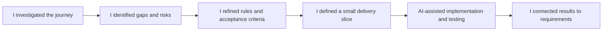
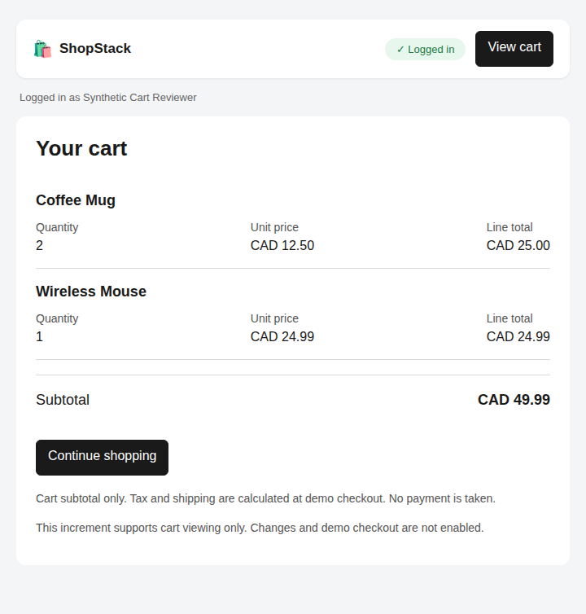

# ShopStack: Business Analysis Case Study

**How I took a missing cart-review journey from discovery to requirements, delivery decisions and executed acceptance evidence.**

**[Read the portfolio website](https://kkrishnan937.github.io/shopstack-ba-portfolio/)** · [Website source](website/)

I acted as the **Business Analyst** in this independent e-commerce portfolio project. I used AI agents to simulate the sponsor, product owner, developer/technical lead, tester, UX and customer-reviewer roles. I asked questions, challenged assumptions, documented decisions and connected business needs to testable requirements.

> Stakeholder discussions, assignments, estimates and approvals were simulated. AI agents also assisted with analysis, documentation, implementation and automated testing. The linked application evidence comes from actual local and CI runs. This was not a real client engagement, and independent customer validation and business sign-off have not occurred.

### How I directed AI agents

**I authored and decided:** I authored and refined the cart business rules and acceptance scenarios with AI feedback. I decided on the 10-unit limit per product/variant, the 30-day retention rule, and checking an unknown update before retrying it.

**I delegated:** I delegated stakeholder role-play, document drafting, code implementation and automated test execution to AI agents.

**I reviewed:** I directed the agents through questions and corrections, checked their proposed behavior against the agreed rules, and kept simulated findings separate from agent-produced execution evidence.

**Start here:** [My one-page case study](docs/case-study.md) · [Actual execution evidence](docs/testing/cart-review-2026-10-28.md) · [Requirements](docs/requirements/cart-requirements.md)

## The business problem

ShopStack supported catalog browsing, login and add-to-cart requests, but customers had no cart page to verify saved selections or totals. I investigated how customers could review and manage their cart without being misled by failed requests, expired carts or unconfirmed updates.

I defined the broader cart-management journey, then narrowed the implemented increment to cart viewing, clear empty/error states and safe retrieval retry. I did not measure conversion, abandonment or financial benefits.



## My role and the simulated team

| Role | How I used it in the project |
|---|---|
| **Business Analyst: me** | I asked discovery and refinement questions, documented requirements and decisions, examined dependencies and linked acceptance scenarios to evidence. |
| Sponsor and product owner: AI agents | I explored objectives, scope, priorities, business rules and acceptance decisions through simulated discussions. |
| Developer and technical lead: AI agents | I asked about feasibility, request status, retention, authentication and delivery impact. |
| Tester: AI agents | I refined expected outcomes, boundaries, failure scenarios, evidence needs and defect handling. Agents later executed automated checks. |
| UX and customer reviewer: AI agents | I explored labels, mobile use, messages and recovery actions. These were exercises, not real usability research. |

## At a glance

| What I produced or supported | Evidence |
|---|---|
| Discovery and stakeholder analysis | [Discovery notes](docs/discovery/meeting-notes-2026-10-23.md), [stakeholder plan](docs/discovery/stakeholder-analysis-and-engagement.md) |
| Current and future process analysis | [Current-state map](docs/process-analysis/ShopStack-Current-State-Improved.png), [future-state diagrams](docs/process-analysis/future-state-diagrams.md) |
| Gap analysis and prioritization | [Gap register](docs/process-analysis/gap-register.md), [decision record](docs/process-analysis/prioritization-and-decisions.md) |
| Cart stories, business rules and acceptance criteria | [Requirements](docs/requirements/cart-requirements.md) |
| Solution clarification and change impact | [Cart-read contract](docs/requirements/cart-read-contract.md), [change handoff](docs/requirements/cart-readiness-change-and-handoff.md) |
| Wireframes and customer communication | [Seven illustrative cart states](docs/wireframes/cart-wireframes.md) |
| Requirements-to-test traceability | [37 mapped test families](docs/requirements/cart-traceability-matrix.md) |
| Test planning and evidence | [UAT pack](docs/testing/cart-uat-pack.md), [execution review](docs/testing/cart-review-2026-10-28.md) |
| Defect analysis practice | [Hypothetical defect exercise](docs/testing/hypothetical-quantity-defect-exercise.md) |

## A guided tour of my work

1. **[Discovery](docs/discovery/meeting-notes-2026-10-23.md):** How I framed the customer journey, assumptions and scope.
2. **[Gap analysis](docs/process-analysis/gap-register.md):** How I connected missing capabilities to priorities.
3. **[Requirements](docs/requirements/cart-requirements.md):** How I specified quantity limits, calculations, retention and uncertain outcomes.
4. **[Diagrams](docs/process-analysis/future-state-diagrams.md) and [wireframes](docs/wireframes/cart-wireframes.md):** How I made states, messages and recovery actions reviewable.
5. **[Delivery handoff](docs/requirements/cart-readiness-change-and-handoff.md):** How I recorded scope changes, dependencies and unresolved questions.
6. **[Traceability](docs/requirements/cart-traceability-matrix.md) and [actual evidence](docs/testing/cart-review-2026-10-28.md):** How I distinguished tested behavior from planned coverage.

## Decisions I can explain in an interview

- **A retrieval error does not mean an empty cart.** I specified separate failure and empty states. Retry retrieves saved data without changing selections.
- **An unknown update is not a confirmed failure.** I explored duplicate-action risks and specified checking the original request instead of blindly resubmitting it. Mutation recovery remains outside the delivered slice.
- **Session expiry and cart expiry need different explanations.** I distinguished sign-in recovery from the 30-day saved-cart retention rule.
- **A small increment needs explicit boundaries.** I defined cart viewing as the first implementation slice while mutation and logout issues remained open.
- **Evidence must support the claim.** I kept simulated findings, hypothetical defects and actual execution records identifiable, including persistence evidence beyond the screen.

## What was actually verified

The real React/Express cart slice displays owned products, quantities, unit prices, line totals and a CAD subtotal. It includes ordinary-empty and expired-cart states, authentication handling and non-mutating Retry. Cart/order writes are disabled in this slice.

**Nine planned test families and six supplemental checks passed locally and in CI on embedded PostgreSQL and PostgreSQL 17.** Repeated executions cover the same scenarios; the remaining **28 planned families are Not run**.

The recovery fixture contained two mugs at CAD 12.50 and one mouse at CAD 24.99. A controlled read failure showed an error without claiming the cart was empty. Retry recovered to **CAD 49.99**; saved-state snapshots confirmed unchanged items and retention metadata.



[Failure screenshot](docs/testing/evidence/cart-review-postgres-2026-10-28/01-cart-load-failure.png) · [Machine-readable results](docs/testing/evidence/cart-review-postgres-2026-10-28/run-results.json) · [CI run](https://github.com/kkrishnan937/shopstack/actions/runs/40808158396)

## Repository map

```text
docs/
  case-study.md        My problem, approach, results and lessons
  discovery/           Discovery, stakeholder analysis and simulated workshops
  process-analysis/    Current/future processes, gaps, priorities and decisions
  requirements/        Stories, rules, acceptance criteria, traceability and handoff
  wireframes/          Illustrative cart screens and explanations
  testing/             Test plans, readiness records, exercises and actual evidence
```

The [application repository](https://github.com/kkrishnan937/shopstack) holds implementation code. This repository holds my BA analysis and supporting evidence.

## Scope and limitations

I present this as a BA portfolio case study. Independent customer research and stakeholder acceptance remain outstanding. The broader requirements include quantity updates, removal, logout and cart policies; those features are not all implemented or verified. Exact retention boundaries, full accessibility and prolonged mutation recovery remain open.

Real payments, fulfilment and stock reservation are excluded. The cart displays item-price subtotal only; tax and shipping belong to proposed later checkout work.

The owner merged [initial PR #1](https://github.com/kkrishnan937/shopstack/pull/1). [Review PR #2](https://github.com/kkrishnan937/shopstack/pull/2) was recorded as a draft with passing checks at the latest review. The AWS workflow failed during credential setup; I do not claim a production release.

## What I learned

I learned to turn uncertainty into focused BA questions: what is confirmed, who needs to decide, what evidence is missing and which work can proceed independently.

My strongest outcome is a small, evidenced customer journey supported by the analysis that shaped it. I can explain the decisions I made and the limits of what the evidence proves.
