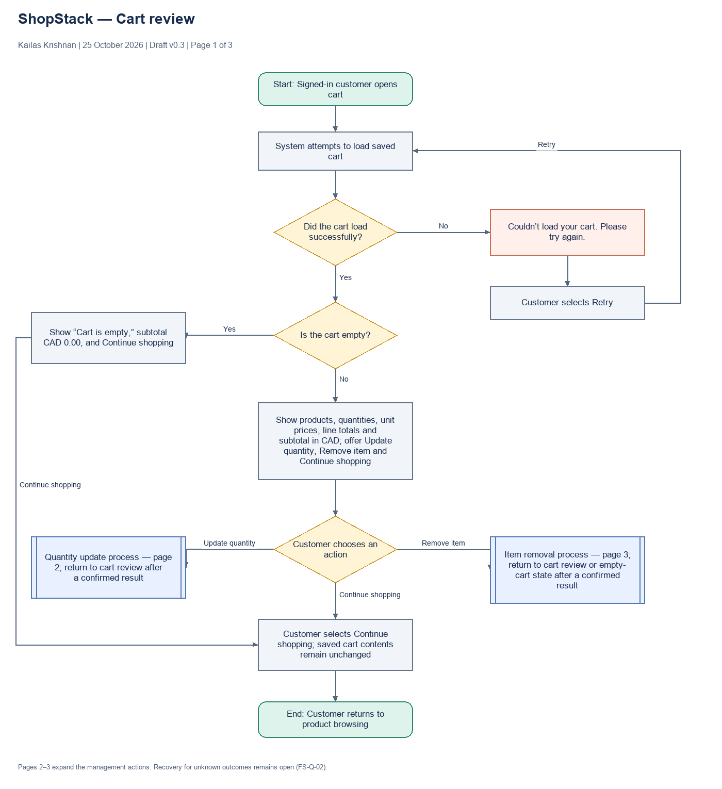
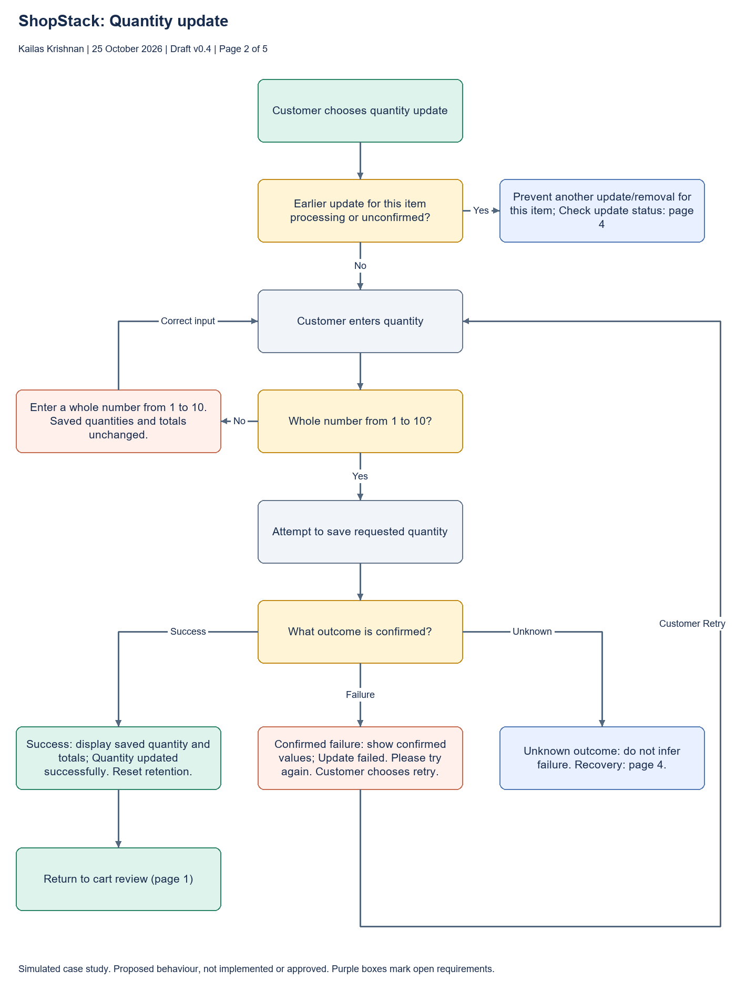
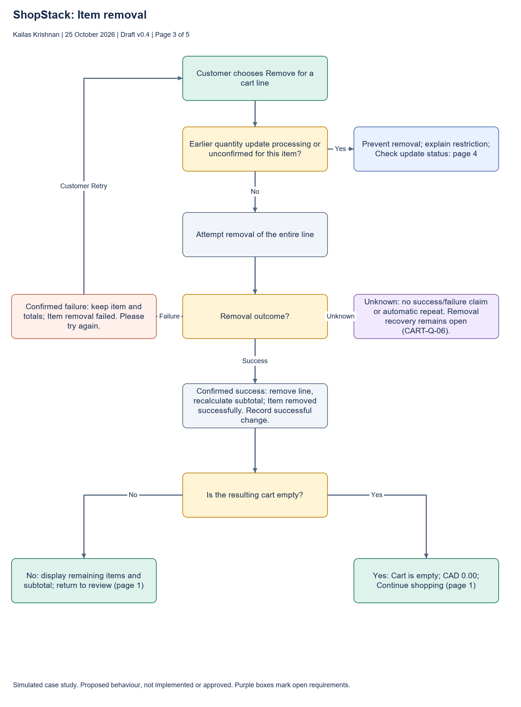
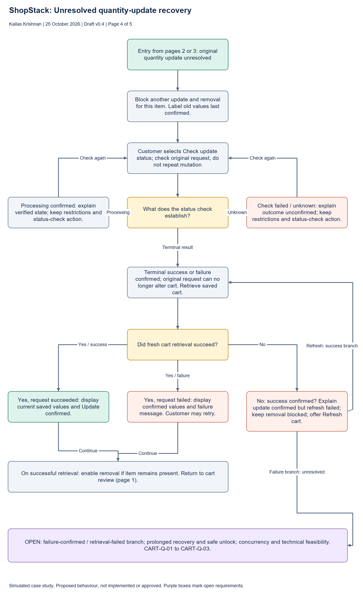
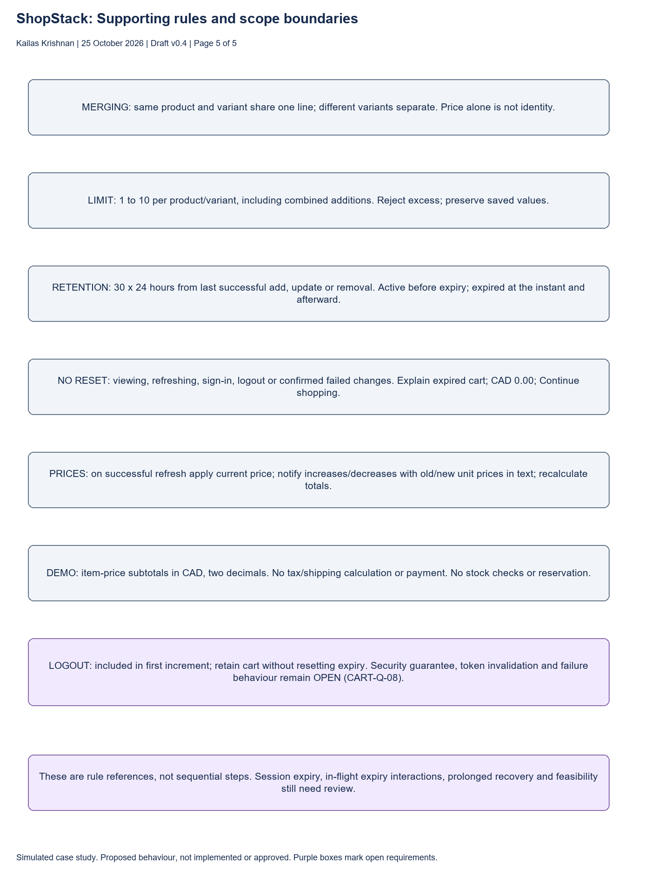

# ShopStack: Future-State Cart Diagrams

**Prepared by:** Kailas Krishnan  
**Date:** 25 October 2026  
**Version:** 0.4
**Status:** Proposed process: draft for review

**Reconciliation:** This revision reflects written process v0.3 and requirements v0.3. It is a simulated case-study draft, not an approved baseline. Status tracking, safe request resolution and logout security are proposed or unresolved, not existing verified functionality.

[Open editable diagram in diagrams.net](https://app.diagrams.net/#Uhttps%3A%2F%2Fraw.githubusercontent.com%2Fkkrishnan937%2Fshopstack-ba-portfolio%2Fmain%2Fdocs%2Fprocess-analysis%2FShopStack-Future-State-Cart-Reviewed.drawio) · [Diagram source](https://raw.githubusercontent.com/kkrishnan937/shopstack-ba-portfolio/main/docs/process-analysis/ShopStack-Future-State-Cart-Reviewed.drawio)

The editable file contains five pages. Blue boxes refer to other pages; yellow boxes mark decisions, green boxes mark entry/confirmed outcomes, and purple boxes identify open requirements. The diagrams use informal flowchart notation, not formal BPMN. Page 5 is a rule reference, not a sequential flow.

The revision adds 1-to-10 validation, conflicting-item restrictions and request-status branches. It preserves the empty/non-empty Continue shopping paths and last-item removal. Prolonged recovery, removal-specific unknown outcomes, failure-confirmed/retrieval-failed handling and logout security remain visibly open. Purple review notes are not customer messages.

## 1. Cart review

## 2. Quantity update

## 3. Item removal

## 4. Unresolved quantity-update recovery

## 5. Supporting rules and scope boundaries

## Generation and verification

The editable XML and PNG previews were generated from shared node/connector definitions. PNGs are generated previews, not exports from the diagrams.net renderer; connector routing and label placement can differ when opened in that editor. The editable draw.io file and PNG previews are retained as the portfolio deliverables.

Generation checks verify that every connector references existing endpoints and all node text fits its assigned box. The five previews were visually inspected and label/routing issues corrected. Interactive editor verification remains pending; no actual customer review, approval or UAT is claimed.

## Related analysis

- [Written future-state process](future-state-cart-process.md)
- [Walkthrough record](future-state-walkthrough.md)
- [Gap register](gap-register.md)

The demo pricing boundary is resolved under DEC-05. See the written process and requirements for the detailed rules, criteria and remaining gaps.
