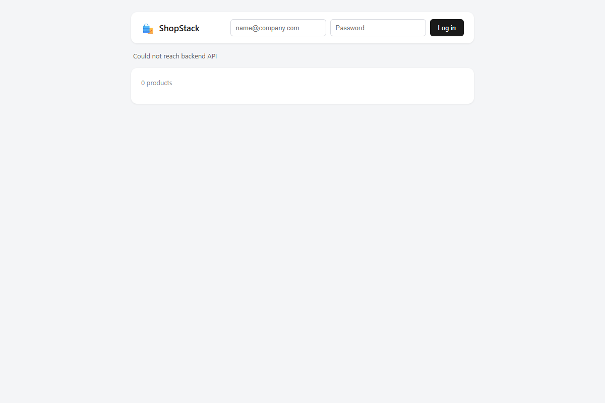

# Cart-loading failure test readiness

**Date:** 28 October 2026  
**Related outlines:** CART-T-04 and CART-T-05  
**Requirements:** CART-FR-01; CART-AC-04 and CART-AC-05  
**Application test status:** Blocked before first customer step

## Environment and scope

Actual local frontend readiness inspection using Vite and headless Microsoft Edge, not the wireframe. Application checkout HEAD: `4f918f173bb8328750e4455af780759f76f82a28`. Portfolio HEAD before this record: `fd91401108ca3a7f066ef6950a50442423740f94`. No tracked application source modifications were made for this check. The isolated browser context was logged out; no real credentials, tokens or customer data were used.

The frontend was served on local loopback port 5173. The backend API/database were not available for this run. This limits runtime observations; source inspection separately establishes that the frontend has no cart-view/retry implementation. No authenticated journey, controlled cart-read failure, retained database state or retry recovery was executed.

## Planned scenario

Preconditions: a synthetic customer signed in with valid authentication, known saved cart data within retention, and a developer/tester-controlled cart-read error in an isolated test environment.

1. Select View cart. Expected: cart-load error and Retry, without claiming empty contents or a confirmed zero subtotal.
2. Select Retry while the controlled failure remains. Expected: another cart retrieval, the error remains, no item changes.
3. Remove the controlled failure and select Retry. Expected: known saved items and totals are displayed and the loading error clears, without mutation.

These are planned steps, not actual results.

## Executed readiness checks and actual observations

| Check | Actual observation |
|---|---|
| Open local frontend | ShopStack rendered; login form visible |
| Look for View cart button or link | Zero matching controls in the rendered logged-out page |
| Look for Retry / Try again button | Zero matching controls |
| Observe cart-read requests on initial load | Zero GET requests to `/api/cart` |
| Observe available page state | "Could not reach backend API" and "0 products"; this concerns the catalog request, not a cart-specific failure |
| Inspect frontend source | `frontend/src/App.jsx` provides catalog loading, login and add-to-cart only. Neither signed-in nor logged-out render branch implements View cart, cart retrieval, cart-load messages or Retry. |
| Inspect backend source | `backend/routes/cart.js` defines authenticated cart retrieval, but the existence of an endpoint does not establish UI delivery or verified behaviour. |

## Blocker and disposition

**BLK-CART-01:** Required customer-facing cart review and retry flow is not implemented. The isolated application's authenticated saved-cart prerequisites are also unavailable in this environment. CART-T-04 and CART-T-05 cannot execute as specified. Record Blocked, not Pass or Fail. The catalog connection error must not be presented as a successful demonstration of cart error handling.

No intentional failure injection or saved-data modification was performed. No application defect against a delivered cart feature is asserted; this is a missing implementation/test-readiness dependency. Prototype checks remain separate from application acceptance evidence.

## Required before rerun

- Implement View cart, saved-cart loading and cart-specific failure/retry behaviour linked to CART-FR-01.
- Provide an isolated running backend/database, synthetic authenticated account and known cart fixture. Confirm a current build reference.
- Establish a reversible cart-read-only failure control without affecting authentication or mutations; record its setup and cleanup.
- Execute all planned steps, compare saved data before/after and attach actual results and evidence. Assign implementation/environment ownership with the delivery roles; none is assigned by this record.

The temporary frontend server started for this inspection was stopped afterward. This record does not authorize implementing the missing feature or changing release scope.

See the [delivery-readiness action log](cart-delivery-readiness-actions.md) for proposed handoff responsibilities and readiness checks. Its owners and timing are simulated, not actual commitments.
