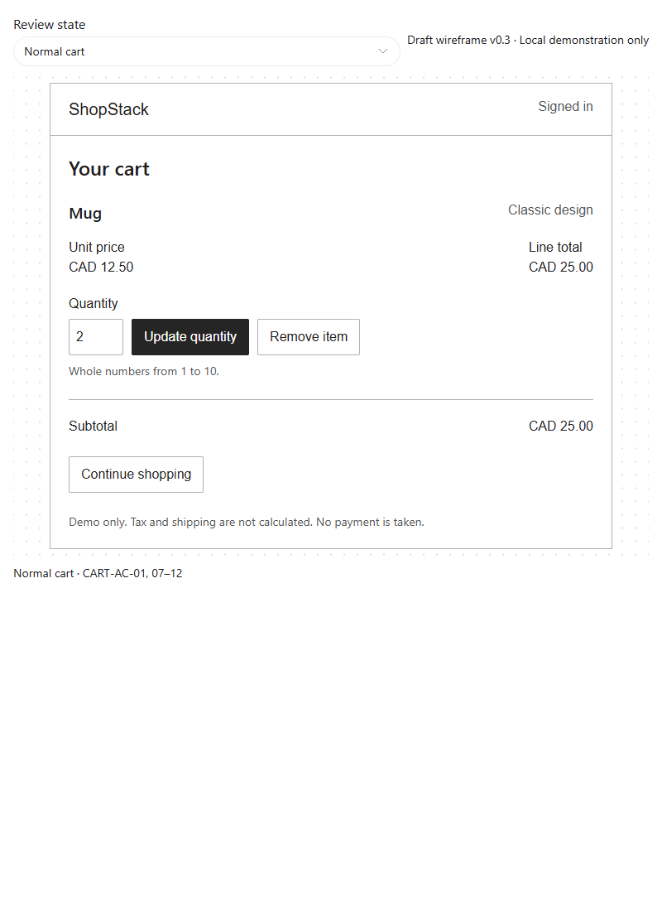
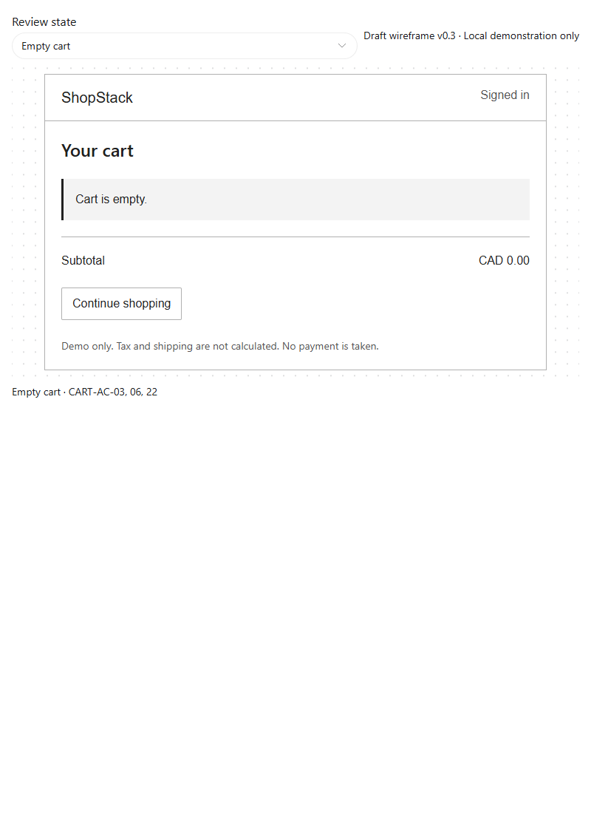
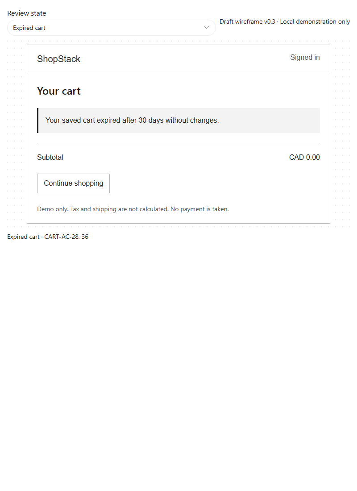
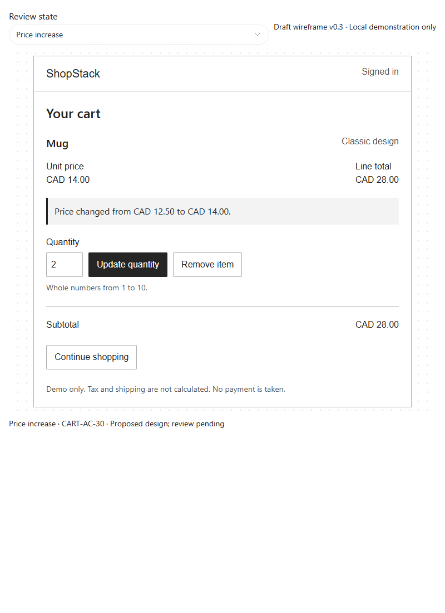
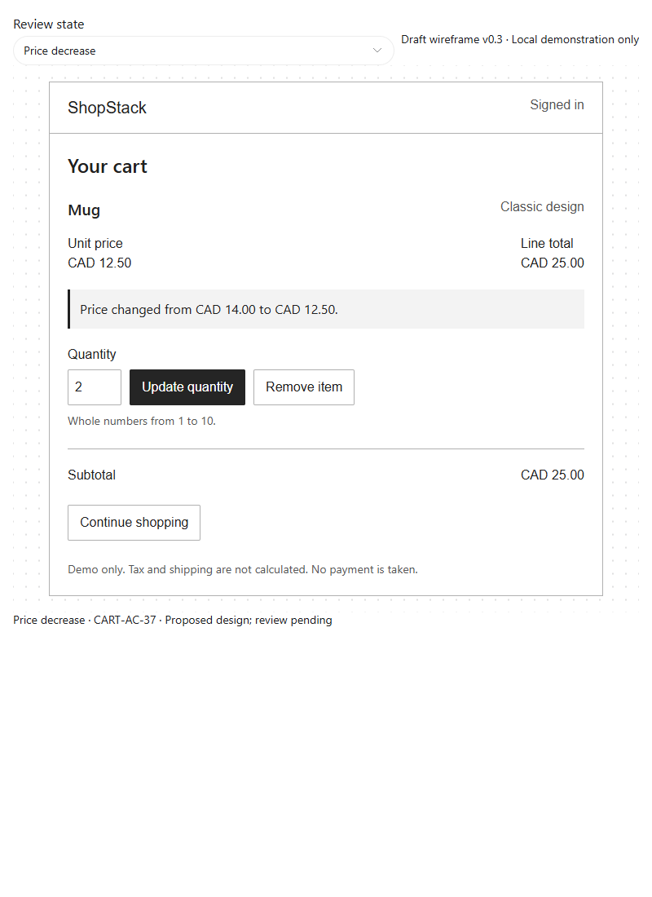
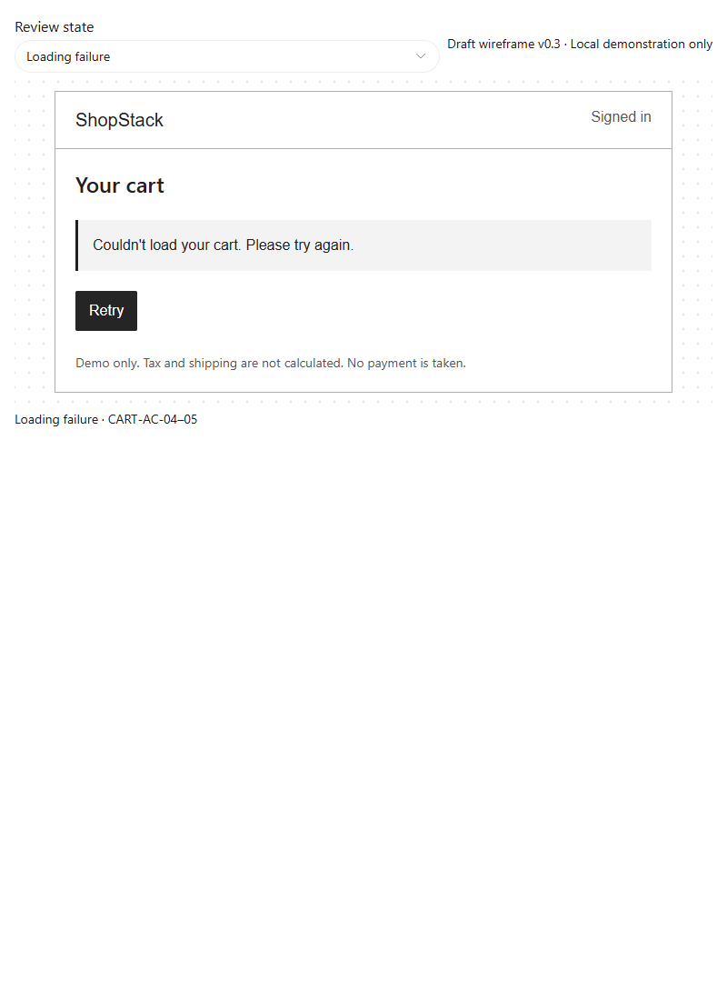
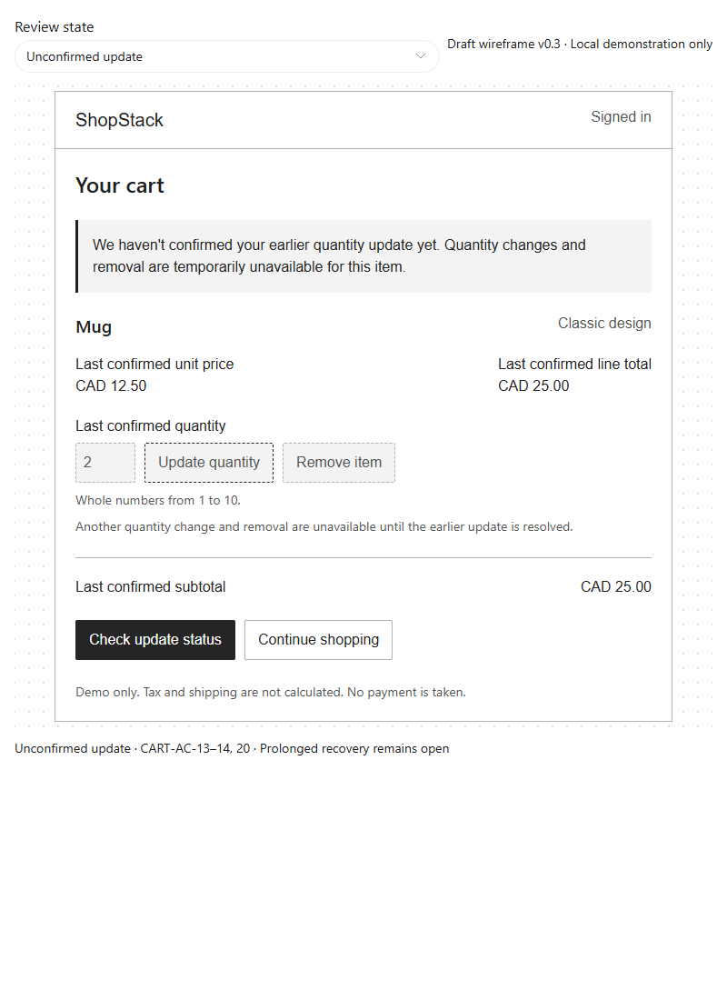

# Cart wireframes

**Version:** 0.3
**Date:** 28 October 2026
**Status:** Proposed low-fidelity design; portfolio author initial review only

## Purpose and scope

Explore the first increment's normal, empty, expired, price-increase, price-decrease, loading-failure and unconfirmed-update states. These are illustrative wireframes with local demonstration interactions, not a working application, verified backend integration, customer validation or executed UAT. The portfolio author gave positive initial feedback on the initial designs; this does not establish requirements approval or usability validation of later changes.

[Download the interactive preview](cart-wireframes.html) and open it locally in a browser. GitHub's file view displays the HTML source rather than hosting the interactive preview. No website deployment is claimed. The Review state selector and acceptance-criteria captions are review aids, not proposed storefront controls.

## Normal cart

Display the product and variant, unit price, quantity, line total and subtotal. Provide clearly labelled Update quantity and Remove item actions, the 1-to-10 input rule, and Continue shopping. Initial example: two mugs at CAD 12.50 each, subtotal CAD 25.00. No checkout action is included in this increment.

References: CART-AC-01, CART-AC-07 through CART-AC-12, CART-AC-21 through CART-AC-22. Local updates demonstrate calculations and validation; local removal demonstrates the empty state. These simulations do not save a real cart or implement retention.

## Empty cart

Show "Cart is empty", subtotal CAD 0.00 and Continue shopping only after an empty state is established. This screen does not represent a loading failure or explain expiry; the separate expired state below covers that cause.

References: CART-AC-03, CART-AC-06, CART-AC-22.

## Expired cart

After successful retrieval establishes that the saved cart expired, show "Your saved cart expired after 30 days without changes", subtotal CAD 0.00 and Continue shopping, with no expired items displayed. This distinguishes retention expiry from an ordinary empty cart. The Review state selector demonstrates the result; it does not calculate or enforce actual retention.

References: CART-AC-28 and CART-AC-36. Added after the simulated wireframe review identified the need to explain why saved items disappeared. Prototype checks verified the explanation, zero subtotal, absent item controls and Continue shopping action; no backend expiry test was performed.

## Price changes

Place the text notice within the affected mug line directly after its price details. Both old and new unit prices are explicit; colour is not needed to understand the change. The increase example shows two mugs changing from CAD 12.50 to CAD 14.00 each, with line total and subtotal CAD 28.00. The decrease example reverses those prices, with line total and subtotal CAD 25.00. Quantity edits in either preview use its current unit price.

References: CART-FR-07, CART-AC-30 and CART-AC-37. These are newly proposed designs, not completed stakeholder validation. The preview selector represents a successful refresh result rather than performing an actual price lookup.

### DG-01: Missing price-notice design coverage

| Field | Record |
|---|---|
| Identified | 28 October 2026, simulated requirements-traceability review |
| Gap | Requirements specified old/new price notices and recalculated totals, but wireframe v0.2 did not depict them. This is a design-coverage gap, not an observed application defect. |
| Response | Added increase and decrease states in v0.3, linked to CART-AC-30 and CART-AC-37. |
| Proposed reviewers | UX/content for placement and clarity; product owner for business meaning; developer for feasibility; tester for criteria coverage. Actual participants are not assigned. |
| Validation | Local prototype checks verified notice values, line/subtotals and no horizontal overflow at 320px for both price states. No application test or customer session was executed. |
| Review scheduling | In the simulation, the BA coordinates with UX and the product owner. Review and findings dates remain unagreed; no actual session is scheduled. |
| Status | Proposed design prepared; stakeholder and customer review pending. Do not mark the gap validated or closed merely because previews exist. |

## Loading failure

Explain that the cart could not be loaded and offer Retry. Do not show an empty-cart claim or a confirmed zero subtotal. Retry in this preview demonstrates another failed retrieval; it makes no network request.

References: CART-AC-04 through CART-AC-05.

## Unconfirmed quantity update

Label previous quantity, unit price, line total and subtotal as last confirmed. Explain why editing and removal of this item are unavailable. Check update status refers to the original request rather than repeating it. The demonstration leaves the outcome unconfirmed when checking again; it does not implement request tracking. Continue shopping represents navigation without altering saved items, not cancellation of the outstanding request.

References: CART-AC-13 through CART-AC-14, CART-AC-20. Prolonged recovery remains unresolved under CART-Q-01. This single-item example does not decide how concurrent actions on other items behave.

## Review notes and remaining work

- All screens identify item-price subtotals in CAD and explain that tax/shipping are not calculated and no payment is taken.
- Native labelled inputs/buttons and status feedback are included. Local checks covered update calculations, invalid-input preservation, blocked unknown-state controls, empty/error presentation and horizontal overflow at 320px and 736px. The standalone export was also checked for update and blocked-control behaviour. These are prototype checks, not application UAT or a complete accessibility audit.
- The unconfirmed-state preview was visually inspected after export. Layout, mobile interaction and accessibility need broader user/team review.
- Logout control and messages are not designed yet because the required token-invalidation guarantee remains open (CART-Q-08). Their omission here does not remove logout from scope.
- Add designs for confirmed failures, authentication expiry and recovery completion as requirements/design review proceeds. Expired-cart presentation was added in v0.2; price-notice states were added in v0.3 and await review.
- Final cart entry/layout choice, UX review, representative customer review and technical feasibility review remain pending.

Sources: [requirements v0.3](../requirements/cart-requirements.md), [future-state process](../process-analysis/future-state-cart-process.md), [stakeholder engagement plan](../discovery/stakeholder-analysis-and-engagement.md).
